<!-- Generated by scripts/build.mjs from profile.json. Edit the config, then run npm run build. -->

<picture>
  <source media="(prefers-color-scheme: dark)" srcset="assets/svg/hero-dark.svg">
  <source media="(prefers-color-scheme: light)" srcset="assets/svg/hero-light.svg">
  
</picture>

<picture>
  <source media="(prefers-color-scheme: dark)" srcset="assets/svg/socials-dark.svg">
  <source media="(prefers-color-scheme: light)" srcset="assets/svg/socials-light.svg">
  
</picture>

<a href="https://t.me/Eerroorree"><picture>
  <source media="(prefers-color-scheme: dark)" srcset="assets/svg/social-telegram-dark.svg">
  <source media="(prefers-color-scheme: light)" srcset="assets/svg/social-telegram-light.svg">
  
</picture></a>
<a href="https://steamcommunity.com/profiles/76561199228246139/"><picture>
  <source media="(prefers-color-scheme: dark)" srcset="assets/svg/social-steam-dark.svg">
  <source media="(prefers-color-scheme: light)" srcset="assets/svg/social-steam-light.svg">
  
</picture></a>
<a href="https://github.com/Sqwer2017"><picture>
  <source media="(prefers-color-scheme: dark)" srcset="assets/svg/social-github-dark.svg">
  <source media="(prefers-color-scheme: light)" srcset="assets/svg/social-github-light.svg">
  
</picture></a>

<picture>
  <source media="(prefers-color-scheme: dark)" srcset="assets/svg/about-dark.svg">
  <source media="(prefers-color-scheme: light)" srcset="assets/svg/about-light.svg">
  
</picture>

<picture>
  <source media="(prefers-color-scheme: dark)" srcset="assets/svg/stack-dark.svg">
  <source media="(prefers-color-scheme: light)" srcset="assets/svg/stack-light.svg">
  
</picture>

<picture>
  <source media="(prefers-color-scheme: dark)" srcset="assets/svg/projects-dark.svg">
  <source media="(prefers-color-scheme: light)" srcset="assets/svg/projects-light.svg">
  
</picture>
<a href="https://github.com/Sqwer2017/noctra"><picture>
  <source media="(prefers-color-scheme: dark)" srcset="assets/svg/project-noctra-dark.svg">
  <source media="(prefers-color-scheme: light)" srcset="assets/svg/project-noctra-light.svg">
  
</picture></a>

<a href="https://github.com/Sqwer2017/anithink"><picture>
  <source media="(prefers-color-scheme: dark)" srcset="assets/svg/project-anithink-dark.svg">
  <source media="(prefers-color-scheme: light)" srcset="assets/svg/project-anithink-light.svg">
  
</picture></a>

<picture>
  <source media="(prefers-color-scheme: dark)" srcset="assets/svg/stats-dark.svg">
  <source media="(prefers-color-scheme: light)" srcset="assets/svg/stats-light.svg">
  
</picture>

<picture>
  <source media="(prefers-color-scheme: dark)" srcset="assets/svg/activity-dark.svg">
  <source media="(prefers-color-scheme: light)" srcset="assets/svg/activity-light.svg">
  
</picture>

<picture>
  <source media="(prefers-color-scheme: dark)" srcset="assets/svg/footer-dark.svg">
  <source media="(prefers-color-scheme: light)" srcset="assets/svg/footer-light.svg">
  
</picture>

<a href="https://sqwer2017.github.io/Sqwer2017/">Open the interactive profile</a> &nbsp;·&nbsp; <a href="https://github.com/Sqwer2017/Sqwer2017">Source</a> &nbsp;·&nbsp; <a href="SETUP.md">Setup &amp; docs</a>

